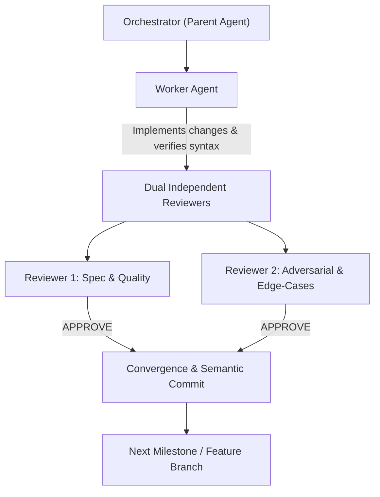

# Unified Remote Development Guide

This skill provides an authoritative reference and operational playbook for developing, refactoring, and validating custom remotes for **Unified Remote Server** (Windows, macOS, Linux).

---

## 1. Core Operating Constraints (Non-Negotiable)

When working on Unified Remote repositories:
1. **Mandatory Feature Branching:** ALWAYS create a dedicated feature branch (`feat/<name>`, `fix/<name>`, `docs/<name>`, `refactor/<name>`) before making any changes. NEVER commit directly to `main` or `master`.
2. **Mandatory Documentation Reconciliation:** ALWAYS reconcile and keep all documentation (skills under `.agents/skills/`, `AGENTS.md`, `README.md`, architecture guides) 100% synchronized and up-to-date whenever modifying code, layouts, metadata, naming, or rules. There are to be NO OUTDATED docs anywhere in the project.
3. **Zero-Test Constraint:** Do **NOT** create test files and do **NOT** execute test suites. Unified Remote remotes are standalone packages; verification must rely strictly on static analysis.
4. **Static Syntax Validation:** Always validate Lua scripts via bytecode compilation (`loadfile` / `luac` / LuaJIT) and XML layouts via XML DOM parsers (`[xml]` in PowerShell or `xml.etree.ElementTree` in Python).
5. **Environment Isolation:** Never run commands that interact with or restart the active Unified Remote Server process or external directories (`%APPDATA%`, `%PROGRAMDATA%`). Confine all edits and scripts strictly to the project workspace.
6. **Path Hygiene & Public Repo Standards:** Do NOT reference external files or embed developer-specific hardcoded paths (such as developer home directories or local drive roots). Keep all documentation, paths, and scripts portable for public repositories using environment variables (`%APPDATA%`, `~/`) or repo-relative paths.
7. **Local Semantic Commits Only:** Commit locally on dedicated feature branches using Conventional Commits (`feat:`, `refactor:`, `fix:`, `docs:`, `chore:`). Never push to remote git remotes or open PRs unless explicitly instructed.
8. **Keybinding Preservation:** When mapping existing applications (such as MPV.NET via `input.conf`), treat user keybinding configuration files as authoritative and immutable (byte-for-byte preservation).

---

## 2. Authoritative Knowledge Sources & Upstream Repositories

Always consult these canonical repositories for official API schemas, control definitions, and working patterns:
- **Unified Remote Documentation:** [https://github.com/unifiedremote/Docs](https://github.com/unifiedremote/Docs)
  - Concepts: `concepts/metadata.md`, `concepts/layout.md`, `concepts/remote.md`, `concepts/cross-platform.md`
  - Controls: `controls/button.md`, `controls/styling.md`, `controls/tabs.md`, `controls/slider.md`, `controls/dialogs.md`
  - Libraries: `libs/keyboard.md`, `libs/script.md`, `libs/ffi.md`, `libs/device.md`, `libs/timer.md`, `libs/server.md`
  - Assets: `res/icons.md` (official icon list), `res/keys.md` (supported virtual key identifiers)
- **Official Remotes Source Code:** [https://github.com/unifiedremote/Remotes](https://github.com/unifiedremote/Remotes)
  - Canonical implementations under `Main/` (e.g., `Main/MPC-HC`, `Main/VLC`, `Main/Power`, `Main/Volume`)
- **Unified Remote GitHub Organization:** [https://github.com/unifiedremote](https://github.com/unifiedremote)
  - Includes `Test-Remotes`, user repositories, and developer resources.

---

## 3. Remote Package Architecture

A Unified Remote custom remote directory lives inside `Remotes/Custom/<RemoteName>/` and consists of:

```
<RemoteName>/
├── meta.prop          # Remote metadata and categorization
├── layout.xml         # XML UI layout (rows, buttons, sliders, tabs)
├── remote.lua         # Lua event handlers, actions, and system libraries
├── icon.png           # 48x48 PNG icon (standard resolution)
└── icon_hires.png     # 96x96 / 128x128 PNG icon (high resolution)
```

---

## 4. Strict Syntax & Specification Rules

### 4.1 Metadata (`meta.prop`)

Format is simple `key: value` pairs.

```properties
meta.name: gMPV
meta.author: g
meta.description: MPV media remote
meta.platform: windows
meta.tags.category: media
```

> **Note:** In UnifiedG, all remotes specify `meta.author: g`. The four canonical remotes are `gMPV` (`media`), `gMPV v2` (`media`), `gSleepTimer` (`utility`), and `gSleepTimer v2` (`utility`). Legacy identifiers (`gbyn`, `SuperTimer`, `Pro`) are strictly prohibited across all remotes and documentation.

#### ⚠️ Critical Traps & Anti-Patterns:
- ❌ **NEVER use `meta.version` or `meta.id`:** The underlying .NET server parses `meta.version` strictly as an integer (`int.Parse`), causing fatal exceptions on floats. Upstream official remotes and UnifiedG remotes omit `meta.version` entirely. `meta.id` does not exist in the schema; the directory name is the remote identifier. Both properties must be omitted entirely.
- **Allowed Categories (`meta.tags.category`):** `media`, `utility`, `input`, `browser`, `gaming`, `presentation`, `legacy`.
- **Allowed Platforms (`meta.platform`):** `windows`, `linux`, `mac` (can specify multiple space-separated: `windows mac`).

---

### 4.2 Layout Definition (`layout.xml`)

Defines the mobile UI hierarchy.

```xml
<?xml version="1.0" encoding="utf-8"?>
<layout lightcolor="#282828" darkcolor="#282828" onVolumeUp="vol_up" onVolumeDown="vol_down">
    <tabs>
        <tab text="Playback">
            <row>
                <button icon="playpause" weight="2" ontap="play_pause" />
                <button icon="stop" weight="1" ontap="stop" />
            </row>
            <row>
                <button text="Mute" icon="vmute" ontap="mute" />
                <button text="Cancel" color="red" ontap="cancel" />
            </row>
        </tab>
    </tabs>
</layout>
```

#### ⚠️ Critical Traps & Anti-Patterns:
- ❌ **NEVER pass hex colors into the `color` attribute:** In Unified Remote, `color="..."` strictly accepts predefined enum color literals:
  - Allowed named colors: `red`, `grey`, `blue`, `green`, `orange`, `purple`, `pink`, `yellow`, `transparent`.
  - Passing `color="#D32F2F"` throws an enum parsing error on the server!
- **Hex Background Colors on `<layout>`:** Use `lightcolor="#hex"` and `darkcolor="#hex"` on the root `<layout>` tag, never `color="#hex"`.
- **Icon Names:** Must match official icon assets:
  - `vmute` (NOT `mute`)
  - `playpause`, `play`, `pause`, `stop`, `previous`, `next`, `rwd`, `ff`
  - `vup`, `vdown`, `fullscreen`
- **Tab Titles:** Avoid raw `&` entities that can break strict XML parsers; use `and` (e.g., `<tab text="Audio and Subs">` instead of `Audio &amp; Subs`).
- **Hardware Volume Buttons:** Bind device volume rocker via `onVolumeUp="..."` and `onVolumeDown="..."` on the root `<layout>` element.

---

### 4.3 Scripting Logic (`remote.lua`)

Executes backend actions in Lua 5.1 / LuaJIT.

```lua
local keyboard = libs.keyboard;
local script = libs.script;
local device = libs.device;
local server = libs.server;
local timer = libs.timer;

-- Helper functions MUST be defined in chunk scope (NO 'local function')
function feedback ()
    pcall(function () device.vibrate(); end);
end

--@help Toggle play / pause playback
actions.play_pause = function ()
    feedback();
    keyboard.stroke("space");
end;

--@help Decrease volume
actions.vol_down = function ()
    keyboard.press("volumedown");
end;
```

#### ⚠️ Critical Traps & Anti-Patterns:
- ❌ **NEVER use `local function` for helpers:** Helper functions must be chunk-scoped (`function helper ()`). Unified Remote executes actions in separate environments; local function closures at file scope can fail or cause scope isolation traps.
- **Formatting Conventions:** Use standard spacing (`actions.name = function ()`) and statement-ending semicolons (`;`) matching official upstream code.
- **Action Metadata Docstrings:** Place `--@help <description>` on the immediate line preceding `actions.<name> = function ()`.
- **Haptic & Toast Safety:** Always wrap `device.vibrate()` and `device.toast()` in `pcall` guards, as some mobile clients do not support them.
- **Windows Shutdown Collision (Error 1190):** Scheduling `shutdown -s -t <sec>` while a previous timer is active causes Windows Error 1190. Always prepend cancellation:
  ```lua
  function schedule_shutdown (seconds)
      script.default("shutdown -a");
      script.default("shutdown -s -t " .. seconds);
  end;
  ```
- **Windows FFI Power Calls (Sleep/Hibernate/Lock):**
  - Follow the official `Power` remote pattern:
  ```lua
  local ffi = nil;
  local PowrProf = nil;
  pcall(function ()
      ffi = require("ffi");
      ffi.cdef[[
      bool LockWorkStation();
      bool SetSuspendState(bool hibernate, bool forceCritical, bool disableWakeEvent);
      ]];
      PowrProf = ffi.load("PowrProf");
  end);

  actions.lock = function ()
      if ffi and ffi.C then
          ffi.C.LockWorkStation();
      else
          script.default("rundll32.exe user32.dll,LockWorkStation");
      end;
  end;
  ```
  - Note: `LockWorkStation` is part of `user32` which is automatically in `ffi.C`. Do **not** call `ffi.load("user32")`.
  - Always provide CLI fallback (`rundll32.exe`, `shutdown -h`, `shutdown -r -t 0`) in case FFI is disabled.

---

## 5. Multi-Agent Orchestration Playbook

When executing complex refactorings or new remote generation, use this 4-role multi-agent workflow:



1. **Role: Orchestrator (Project Owner)**
   - Plans milestones and creates dedicated feature branches (`feat/<name>`, `fix/<name>`, `docs/<name>`, `refactor/<name>`). Never commits directly to `main` or `master`.
   - Ensures strict constraint isolation.
   - Spawns and manages subagents; does not execute code directly.
2. **Role: Worker Agent**
   - Implements code improvements and fixes.
   - Validates syntax in-memory via local compilers before reporting back.
3. **Role: Reviewer 1 (Code Quality & Spec Compliance)**
   - Audits `meta.prop` against official metadata schema.
   - Audits `layout.xml` for valid control colors, hierarchy, and tags.
   - Verifies zero `local function` in `remote.lua`.
   - Verifies 0 test files created and `input.conf` byte-for-byte preservation.
   - Verifies documentation reconciliation: ensures `README.md`, `AGENTS.md`, and skill guides reflect current naming and behavior without outdated artifacts.
4. **Role: Reviewer 2 (Adversarial & Edge-Cases)**
   - Verifies 100% action binding coverage: every `ontap`, `onVolumeUp`, `onVolumeDown` maps to an action.
   - Checks XML well-formedness, ensures tab titles use `and` instead of `&` or `&amp;`, and verifies FFI fallback safety.
   - Confirms local semantic commit history on dedicated feature branches and clean git status.

---

## 6. Automated Static Validation Commands

Run these PowerShell one-liners to validate all remotes without tests or external process interactions:

```powershell
# 1. Validate all XML layouts for well-formedness
Get-ChildItem -Path "gMPV*", "gSleepTimer*" -Recurse -Filter "layout.xml" | ForEach-Object {
    try {
        $xml = [xml](Get-Content -Raw $_.FullName)
        Write-Host "PASS XML: $($_.FullName)" -ForegroundColor Green
    } catch {
        Write-Host "FAIL XML: $($_.FullName) - $($_.Exception.Message)" -ForegroundColor Red
    }
}

# 2. Validate all Lua scripts for syntax errors via LuaJIT compiler
Get-ChildItem -Path "gMPV*", "gSleepTimer*" -Recurse -Filter "remote.lua" | ForEach-Object {
    $res = nvim -u NONE --headless -c "lua local ok, err = loadfile([[$($_.FullName)]]); if not ok then print('ERROR: ' .. err); vim.cmd('cquit 1') else print('OK') end" -c "q" 2>&1
    if ($LASTEXITCODE -eq 0) {
        Write-Host "PASS LUA: $($_.FullName)" -ForegroundColor Green
    } else {
        Write-Host "FAIL LUA: $($_.FullName) - $res" -ForegroundColor Red
    }
}

# 3. Verify zero illegal properties in meta.prop
Get-ChildItem -Path "gMPV*", "gSleepTimer*" -Recurse -Filter "meta.prop" | ForEach-Object {
    $content = Get-Content $_.FullName
    if ($content -match "meta\.version" -or $content -match "meta\.id") {
        Write-Host "FAIL META: $($_.FullName) contains illegal version or id property!" -ForegroundColor Red
    } else {
        Write-Host "PASS META: $($_.FullName)" -ForegroundColor Green
    }
}
```
